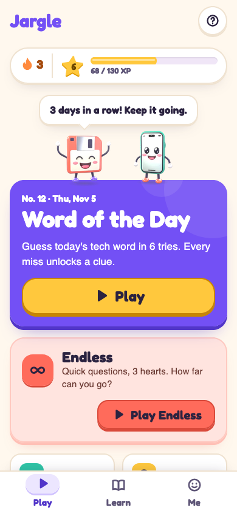
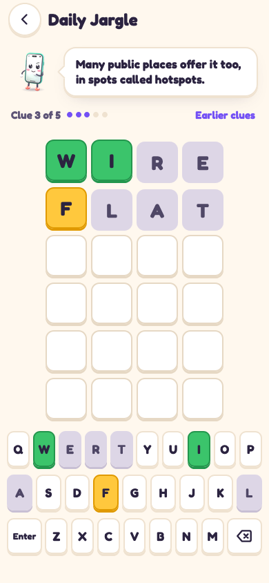
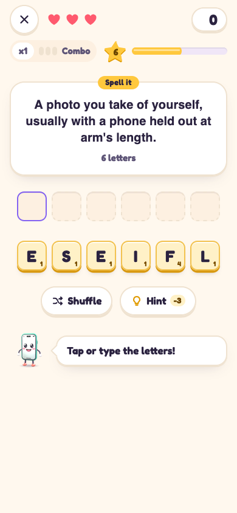
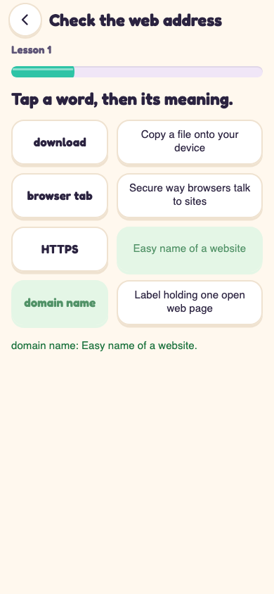
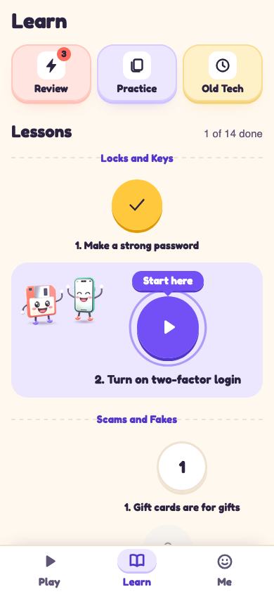
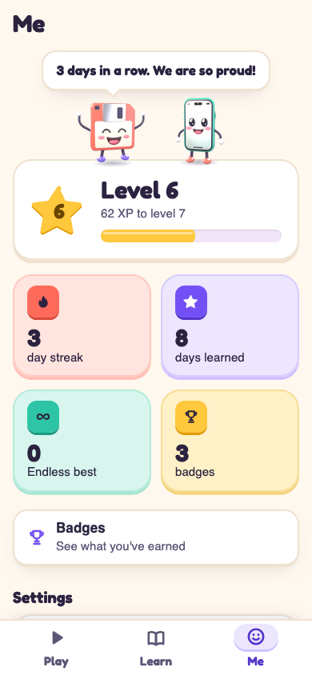
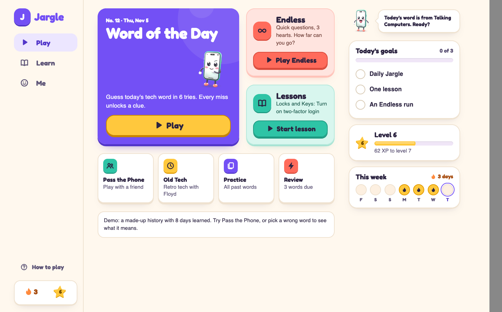

<!-- markdownlint-disable MD013 MD033 MD041 -->
<p align="center">
  
</p>

# Jargle

A daily game where you guess today's tech word from clues. Your hosts are Floyd the floppy disk and Bud the smartphone, who each know something the other doesn't. For anyone who has ever asked "What is a Claude?"

It is made for adults who were handed new tech with no one to explain the words. You get one new word a day, and everyone plays the same one. When you want more, short lessons and Endless mode keep the questions coming. A wrong guess still teaches you something.

- **Play in your browser:** <https://whyater.github.io/Jargle/>
- **Judge demo:** <https://whyater.github.io/Jargle/?demo=judge> (a made-up history, so you can see the game after a few days of play)

---

## A day in Jargle

Jargle has three tabs at the bottom. They are Play, Learn and Me. On a big screen they move to a side nav, with your goals for the day on the right.

1. Open Jargle. **Play** shows the Daily Jargle, your streak and your level.
2. Read the first clue. Type a guess and press Enter. The word has 4 to 7 letters, and you get 6 tries.
3. Each tile shows how close you are. **Green** means the right letter in the right spot. **Yellow** means the letter is in the word, but somewhere else. **Gray** means it is not in the word.
4. Every miss unlocks one more clue, up to five. Some days the answer is a key word of a longer term, like LOGIN for two-factor login. A "Key word" tag tells you when that happens.
5. When the game ends you see the meaning and a short chat between Floyd (the floppy disk) and Bud (the smartphone). Each word also links to the pages its facts came from. **Learn the lesson** opens a short mini lesson on that word.
6. Share a short line like "Jargle Day 12 4/6" with colored squares and no letters, if you want to. Your streak ends only after two missed days in a row.

There are no accounts and no timers. Right answers give you XP, and XP moves you up levels. Hearts only show up in Endless mode.

### Lessons

**Learn** shows the lessons as a path, on topics like passwords and two-factor login. Each lesson is 8 short steps. The steps are short cards, Match pairs, a fill in the blank and a scam or safe moment, then a check question, a spelling step called Build it and a recap. Anything you miss comes back near the end and later in **Review**. Each lesson can win up to 3 stars, and you can replay a lesson any time.

### Endless mode

Done with today's word? Endless lets you keep playing. You get 3 hearts, and a wrong answer takes one away. Right answers in a row build a combo, and the questions get harder as you go. Your best score is saved. Questions come in six kinds:

- **Clue Climb:** guess the word from clues.
- **Meaning Match:** see a word and pick what it means.
- **Name It:** read a meaning and pick the word.
- **True or False:** does this word mean this?
- **Old or New:** is this old tech, or something you would see today?
- **Spell it:** read a meaning and tap or type the letters to spell the word. A hint costs points.

Endless asks about the words released so far, plus a bank of extra words (91 so far) that are never the word of the day.

Around the daily word:

- **Review** brings back words you missed or learned a few days ago.
- **Old Tech** is a set of old-tech words (rotary phone, floppy disk, phone book) where you might know more than Bud.
- **Pass the Phone** lets two people share one phone and swap who reads the clues.
- **Practice** replays past words as clue rounds. Rounds that cannot count say so on screen.
- **Me** holds your level, XP, stats, badges and settings, including a text size setting (Normal, Large, Largest).

---

## Install

You do not have to install anything. The website works in a current browser on a phone or computer. These options add an icon and let it open like an app.

### Mac

Open Terminal (press Command and Space, type Terminal, press Return) and paste this line:

```sh
curl -fsSL https://whyater.github.io/Jargle/install.sh | bash
```

Or download [Jargle-mac.dmg](https://github.com/Whyater/Jargle/releases/latest/download/Jargle-mac.dmg). The app is not signed with a paid Apple certificate, so macOS may block it the first time. Right-click Jargle in Applications, choose **Open**, then choose **Open** again. On newer macOS versions with no Open button, go to System Settings, then Privacy & Security, scroll down and click **Open Anyway**. The one-line command skips these steps.

The Mac and Windows apps update themselves. Jargle checks GitHub for a newer version a few seconds after you open it. It checks again every 6 hours while it is running. If there is one, a card says "A new Jargle is ready!" and **Update now** installs it. You do not need to download anything again. Android does not update itself yet: download the new APK from the releases page. The website refreshes on its own, and shows "New version ready, tap to refresh" if a new one arrives while it is open.

### Windows

Open PowerShell and run:

```powershell
irm https://whyater.github.io/Jargle/install.ps1 | iex
```

Or download [Jargle-windows-setup.exe](https://github.com/Whyater/Jargle/releases/latest/download/Jargle-windows-setup.exe). It installs for your account only, so it doesn't need admin access. If SmartScreen says "Windows protected your PC", click **More info**, then **Run anyway**.

### Android

1. On your phone, open [Jargle-android.apk](https://github.com/Whyater/Jargle/releases/latest/download/Jargle-android.apk) in your browser (the other files are on the [releases page](https://github.com/Whyater/Jargle/releases/latest)).
2. Let it download.
3. Open the file. Android will ask whether to allow installs from your browser. Say yes, then tap **Install**.

### iPhone and iPad

There is no App Store version. Use the website instead:

1. Open <https://whyater.github.io/Jargle/> in **Safari**.
2. Tap the **Share** button.
3. Tap **Add to Home Screen**, then **Add**.

### Uninstall

On a Mac, this removes the app and keeps your progress:

```sh
curl -fsSL https://whyater.github.io/Jargle/uninstall.sh | bash
```

To remove your saved progress too:

```sh
curl -fsSL https://whyater.github.io/Jargle/uninstall.sh | bash -s -- --purge
```

On Windows, use Settings, then Apps, then Jargle. More detail is in [install/README.md](install/README.md).

---

## Privacy

- Jargle has no accounts, ads or analytics.
- Your progress is saved on your device only. The Mac, Windows and Android apps ask the server for new words, and the server keeps ordinary web logs, but your progress is not sent.
- The clues and answers are written ahead of time and stored in the app, so nothing is generated while you play.
- The Mac and Windows apps also ask GitHub whether a newer version exists, and that request never includes your progress.
- To move to a new phone, use **Get a progress code** in Settings and type it in on the other device.

---

## How it is built

- **Web app.** [Preact](https://preactjs.com/), TypeScript and [Vite](https://vite.dev/). It is a small static site that works offline once loaded and has no server code.
- **Mac and Windows.** [Tauri](https://tauri.app/) wraps the same web build, with its updater plugin for self-updates.
- **Android.** [Capacitor](https://capacitorjs.com/) wraps the same web build.
- **Server.** [Caddy](https://caddyserver.com/) on an Oracle Cloud VM hosts the site and a mirror of the downloads. The Mac, Windows and Android apps also ask it for new words.
- **Builds and releases.** GitHub Actions runs the tests and builds the installers. GitHub Pages hosts the public site.
- **Mascots and icon.** Floyd and Bud are 3D characters made in Blender by a script in `art/`. They are small WebP images, so the app has no 3D code.
- **Sounds** are made inside the app with the Web Audio API, so there are no audio files. Tiles, keys, lessons and Endless each have their own.

| Folder | What is in it |
| --- | --- |
| `web/` | The app. Game rules are in `src/engine`, screens and art in `src/ui`, and saving and offline support in `src/platform` |
| `content/` | Every word, lesson and the schedule, as plain JSON |
| `scripts/` | The content checker and bundle builder |
| `desktop/` | The Tauri shell for Mac and Windows |
| `mobile/` | The Capacitor shell for Android |
| `install/` | The one-line installers for Mac and Windows |
| `server/` | Setup files for the Caddy server |
| `assets/` | The app icon |
| `art/` | The Blender script that renders Floyd and Bud |

### Run it yourself

You need Node 20 or newer.

```sh
cd web
npm ci
npm run dev
```

Then open the address Vite prints. To run the tests:

```sh
cd web
npm test
```

To check the word files from the repo root:

```sh
node scripts/content-check.mjs
```

The Mac, Windows and Android apps build in GitHub Actions. You only need the web app to work on the game.

### Add a word

Words are JSON files in `content/items/`. Each one has clues, three decoys, and links to the pages it came from. The steps are in [content/README.md](content/README.md), and the checker catches most mistakes.

---

## About the content

Every word lists the sources it came from, and the app shows them under "Where this comes from." Once a person checks an item against its sources, its `checked_on` field gets the date. An item with no date has not been checked yet, and right now that is every item.

## Known limitations

- The daily schedule starts on Sunday, October 25, 2026 and runs through Saturday, December 5, 2026 (42 days, plus 12 Old Tech words and 14 lessons). The chatbot topics come later in the schedule, after the basics. More words are added over time.
- The Mac and Windows apps are not signed with paid certificates, so both systems show a warning on first open.
- Android and the website do not update through the app yet. Android needs a new download.
- There is no Linux app and no App Store app. Use the website.
- No word item has been checked by a person yet (see above).

## Screenshots

<p>
  
  
  
  
  
  
</p>

On a big screen the Play tab becomes a side nav, a card layout and a goals panel:

<p>
  
</p>

---

## Credits and license

Fonts, libraries and tools are listed in [CREDITS.md](CREDITS.md). Jargle is released under the [MIT License](LICENSE). Copyright (c) 2026 Abyan.
