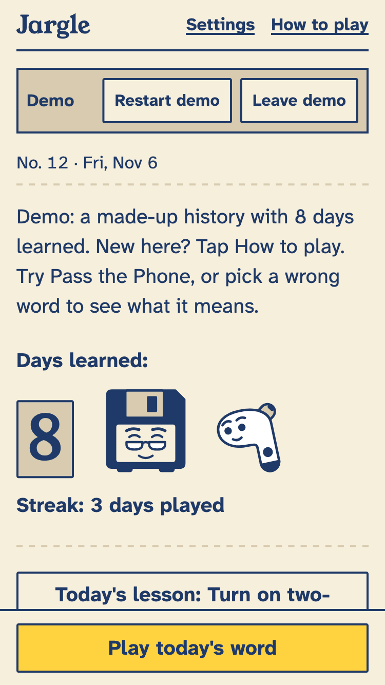
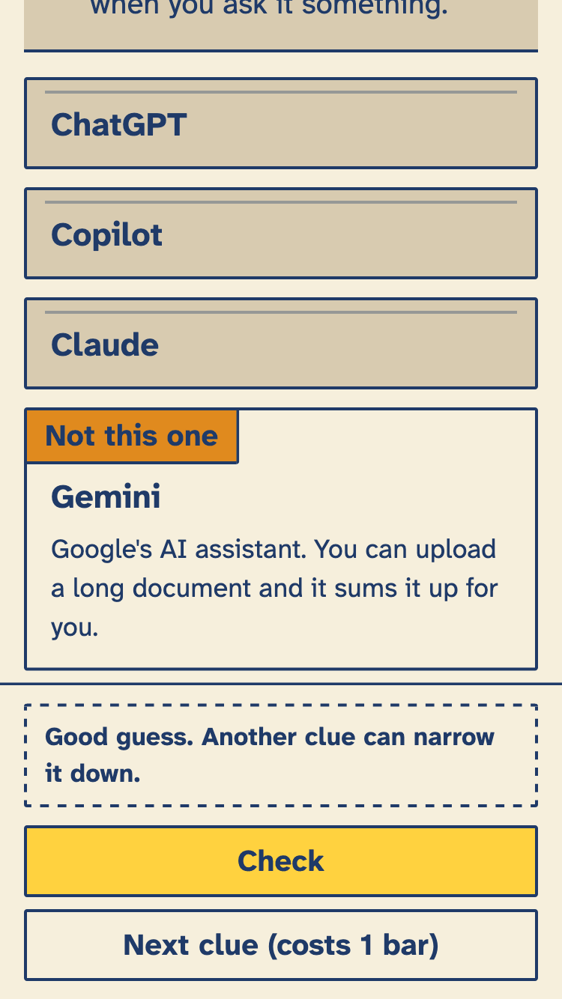
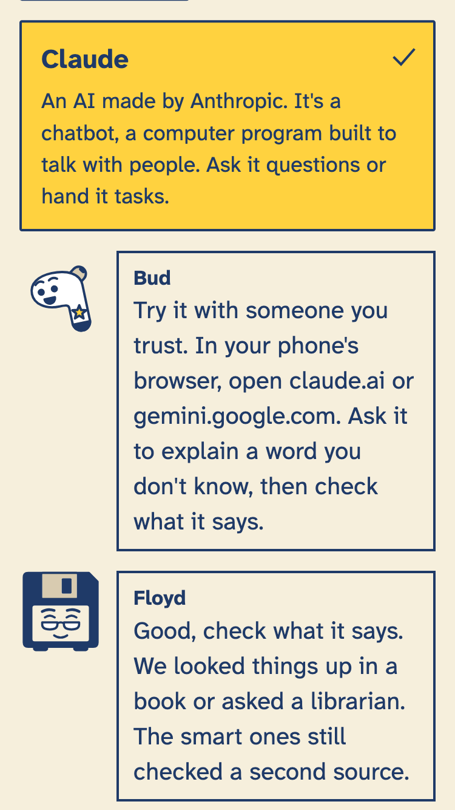
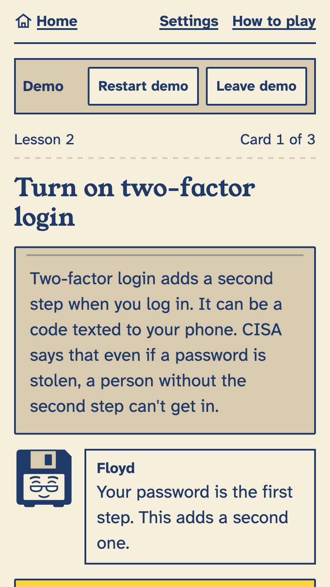
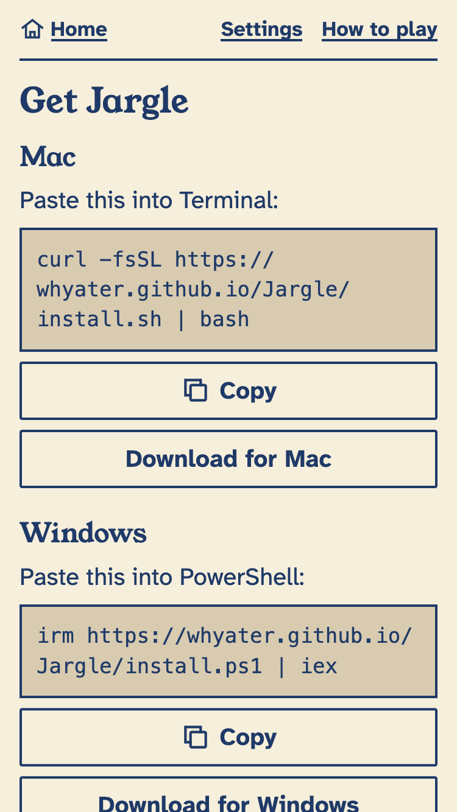

<!-- markdownlint-disable MD013 MD033 MD041 -->
<p align="center">
  
</p>

# Jargle

A daily game where you guess today's tech word from clues, hosted by a floppy disk and an earbud who each know something the other doesn't. For anyone who has ever asked "What is a Claude?"

It is made for adults who were handed new tech with no one to explain the words. You get one new word a day, and everyone plays the same one. A wrong guess still teaches you something.

- **Play in your browser:** <https://whyater.github.io/Jargle/>
- **Judge demo:** <https://whyater.github.io/Jargle/?demo=judge> (a made-up history, so you can see the game after a few days of play)

---

## A day in Jargle

1. Open Jargle. Home shows today's word, your **Days learned** and your streak.
2. Read the first clue. Pick one of four answer cards, then tap **Check**. Not sure? Tap **Next clue** for an easier one.
3. A 6-bar battery replaces a clock. Taking an extra clue uses 1 bar (the last clue is free) and a wrong guess uses 3. If the bars run out, Jargle shows the answer and the day still counts as learned.
4. A wrong card flips over and shows what that word means. You learn a second word that way.
5. After the round you see the meaning and a short chat between Floyd (the floppy disk) and Bud (the earbud). Each word also links to the pages its facts came from.
6. Share a short line like "Jargle #12: 4 bars left" if you want to. There are no accounts, points, hearts or timers. Your streak ends only after two missed days in a row.

Around the daily word:

- **Lessons** on topics like passwords and two-factor login.
- **Review** brings back words you learned a few days ago.
- **Floyd's Old Tech** is a set of old-tech words (rotary phone, floppy disk, phone book) where you might know more than Bud.
- **Pass the Phone** lets two people share one phone and swap who reads the clues.
- **Practice** replays past words. Rounds that cannot count say so on screen.
- **Badges** and a text size setting (Normal, Large, Largest). Tap targets are 48 px or larger.

---

## Install

You do not have to install anything. The website works in a current browser on a phone or computer. These options add an icon and let it open like an app.

### Mac

Open Terminal (press Command and Space, type Terminal, press Return) and paste this line:

```sh
curl -fsSL https://whyater.github.io/Jargle/install.sh | bash
```

Or download [Jargle-mac.dmg](https://github.com/Whyater/Jargle/releases/latest/download/Jargle-mac.dmg). The app is not signed with a paid Apple certificate, so macOS may block it the first time. Right-click Jargle in Applications, choose **Open**, then choose **Open** again. On newer macOS versions with no Open button, go to System Settings, then Privacy & Security, scroll down and click **Open Anyway**. The one-line command skips these steps.

### Windows

Open PowerShell and run:

```powershell
irm https://whyater.github.io/Jargle/install.ps1 | iex
```

Or download [Jargle-windows-setup.exe](https://github.com/Whyater/Jargle/releases/latest/download/Jargle-windows-setup.exe). It installs for your account only, so it doesn't need admin access. If SmartScreen says "Windows protected your PC", click **More info**, then **Run anyway**.

### Android

1. On your phone, open [Jargle-android.apk](https://github.com/Whyater/Jargle/releases/latest/download/Jargle-android.apk) in your browser (the other files are on the [releases page](https://github.com/Whyater/Jargle/releases/latest)).
2. Let it download.
3. Open the file. Android will ask whether to allow installs from your browser. Say yes, then tap **Install**.

### iPhone and iPad

There is no App Store version. Use the website instead:

1. Open <https://whyater.github.io/Jargle/> in **Safari**.
2. Tap the **Share** button.
3. Tap **Add to Home Screen**, then **Add**.

### Uninstall

On a Mac, this removes the app and keeps your progress:

```sh
curl -fsSL https://whyater.github.io/Jargle/uninstall.sh | bash
```

To remove your saved progress too:

```sh
curl -fsSL https://whyater.github.io/Jargle/uninstall.sh | bash -s -- --purge
```

On Windows, use Settings, then Apps, then Jargle. More detail is in [install/README.md](install/README.md).

---

## Privacy

- Jargle has no accounts, ads or analytics.
- Your progress is saved on your device only. The Mac, Windows and Android apps ask the server for new words, and the server keeps ordinary web logs, but your progress is not sent.
- There are no AI features while you play. The clues and answers are written ahead of time and stored in the app.
- To move to a new phone, use **Get a progress code** in Settings and type it in on the other device.

---

## How it is built

- **Web app.** [Preact](https://preactjs.com/), TypeScript and [Vite](https://vite.dev/). It is a small static site that works offline once loaded and has no server code.
- **Mac and Windows.** [Tauri](https://tauri.app/) wraps the same web build.
- **Android.** [Capacitor](https://capacitorjs.com/) wraps the same web build.
- **Server.** [Caddy](https://caddyserver.com/) on an Oracle Cloud VM hosts the site and a mirror of the downloads. The Mac, Windows and Android apps also ask it for new words.
- **Builds and releases.** GitHub Actions runs the tests and builds the installers. GitHub Pages hosts the public site.
- **Sounds** are made inside the app with the Web Audio API, so there are no audio files.

| Folder | What is in it |
| --- | --- |
| `web/` | The app. Game rules are in `src/engine`, screens and art in `src/ui`, and saving and offline support in `src/platform` |
| `content/` | Every word, lesson and the schedule, as plain JSON |
| `scripts/` | The content checker and bundle builder |
| `desktop/` | The Tauri shell for Mac and Windows |
| `mobile/` | The Capacitor shell for Android |
| `install/` | The one-line installers for Mac and Windows |
| `server/` | Setup files for the Caddy server |
| `assets/` | The app icon |

### Run it yourself

You need Node 20 or newer.

```sh
cd web
npm ci
npm run dev
```

Then open the address Vite prints. To run the tests:

```sh
cd web
npm test
```

To check the word files from the repo root:

```sh
node scripts/content-check.mjs
```

The Mac, Windows and Android apps build in GitHub Actions. You only need the web app to work on the game.

### Add a word

Words are JSON files in `content/items/`. Each one has clues, three decoys, and links to the pages it came from. The steps are in [content/README.md](content/README.md), and the checker catches most mistakes.

---


## Known limitations

- The daily schedule runs through Sunday, December 6, 2026 (42 days, plus 12 Old Tech words and 14 lessons). More words are added over time.
- The Mac and Windows apps are not signed with paid certificates, so both systems show a warning on first open.
- There is no Linux app and no App Store app. Use the website.
- No word item has been checked by a person yet (see above).

## Screenshots

<p>
  
  
  
  
  
</p>

---

## Credits and license

Fonts, libraries and tools are listed in [CREDITS.md](CREDITS.md). Jargle is released under the [MIT License](LICENSE). Copyright (c) 2026 Abyan.
